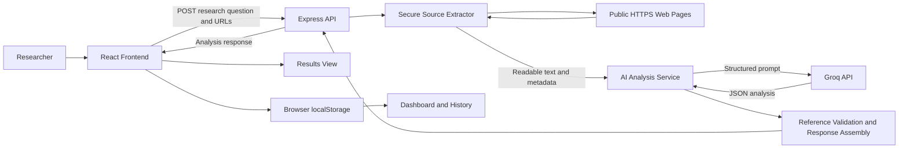
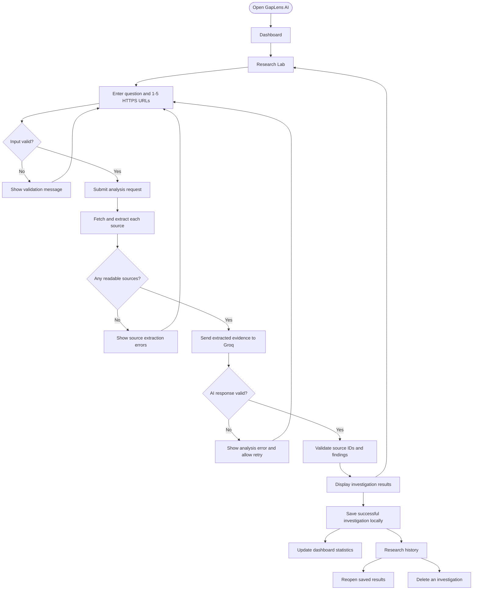
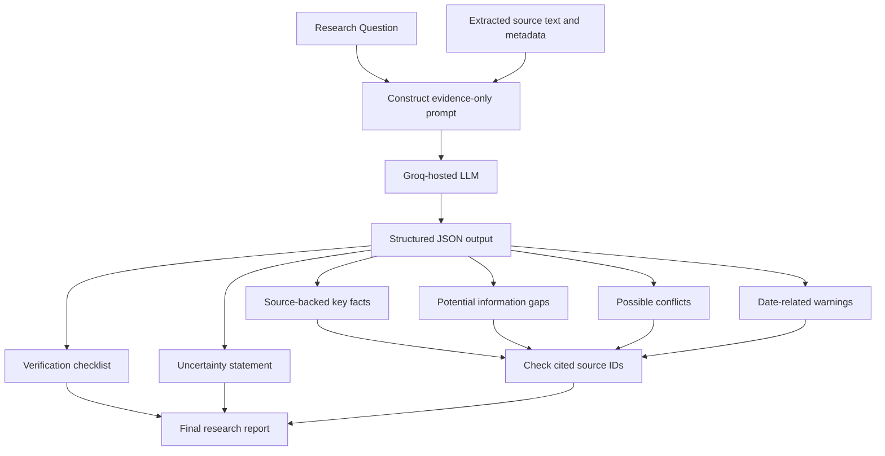

# GapLens AI

**AI-Assisted Information Gap Detection Platform**

GapLens AI is a research-assistance web application built for the **Digital Dark Spot** problem statement in **Shinchan Online Hackathon 2026**. It helps users examine publicly accessible web sources, identify what the supplied evidence establishes, surface potentially missing information, flag possible contradictions, and create a practical verification checklist.

Rather than treating an AI-generated summary as a definitive answer, GapLens AI emphasizes **traceable evidence, uncertainty, and next steps**.

> **Project status:** Working prototype under active development. Source extraction and Groq integration have been exercised locally. Some capabilities described below depend on the current frontend integration and should be verified end-to-end before submission.

## Table of Contents

1. [Problem Statement](#problem-statement)
2. [Proposed Solution](#proposed-solution)
3. [Core Features](#core-features)
4. [System Architecture](#system-architecture)
5. [Application Flowchart](#application-flowchart)
6. [AI Analysis Workflow](#ai-analysis-workflow)
7. [Technology Stack](#technology-stack)
8. [Project Structure](#project-structure)
9. [Installation and Setup](#installation-and-setup)
10. [Environment Configuration](#environment-configuration)
11. [Running the Application](#running-the-application)
12. [API Overview](#api-overview)
13. [Response Data Model](#response-data-model)
14. [Using GapLens AI](#using-gaplens-ai)
15. [Evidence and Reliability Principles](#evidence-and-reliability-principles)
16. [Security and Privacy](#security-and-privacy)
17. [Testing Guide](#testing-guide)
18. [Known Limitations](#known-limitations)
19. [Future Improvements](#future-improvements)
20. [Hackathon Demonstration](#hackathon-demonstration)

## Problem Statement

Researching a topic online often produces abundant information without revealing whether the available evidence is complete, consistent, or current. A user may read several pages and still miss important eligibility criteria, deadlines, exceptions, definitions, or verification steps.

Traditional search engines primarily retrieve pages. Generic summarizers condense what is present. Neither necessarily makes it easy to see **what the selected sources do not establish**.

The **Digital Dark Spot** challenge is to help researchers identify such blind spots without inventing facts or overstating certainty.

### Key challenges

- Important details may be absent from the selected pages.
- Sources may use different terminology or make potentially incompatible claims.
- Publication and update dates may be unavailable or ambiguous.
- AI-generated explanations may sound authoritative without sufficient evidence.
- Users need actionable follow-up questions, not just another summary.

## Proposed Solution

GapLens AI provides a guided investigation workflow:

1. A user enters a focused research question.
2. The user adds one to five public HTTPS source URLs.
3. The backend retrieves and extracts readable page content.
4. Successfully extracted sources are passed to a Groq-hosted language model.
5. The model returns structured findings: summary, supported facts, potential gaps, possible conflicts, date-related warnings, a verification checklist, and uncertainty notes.
6. The backend filters invalid source references before returning the analysis.
7. The frontend presents the findings and, when its history integration is enabled, stores completed investigations locally for later review.

**Important distinction:** A gap means that information was **not established by the supplied sources**. It does not prove that the information is unavailable on the internet or in official records.

## Core Features

| Feature | Description |
| --- | --- |
| Research question input | Enter a specific question to guide the investigation. |
| Multi-source analysis | Submit between one and five source URLs. |
| Website text extraction | Retrieve readable text and basic page metadata from accessible HTML pages. |
| Evidence-oriented AI analysis | Generate structured findings based on the extracted source text. |
| Key facts | Present claims tied to source identifiers. |
| Potential information gaps | Identify relevant questions that the provided sources do not answer. |
| Possible contradictions | Flag incompatible claims when supported by at least two sources. |
| Date-related warnings | Highlight claims that may need freshness verification. |
| Verification checklist | Suggest prioritized actions for resolving uncertainty. |
| Research results interface | Display analysis sections in a readable dashboard-style layout. |
| Research overview | Calculate investigation, source, gap, and conflict totals from saved results. |
| Research history | Save, search, revisit, and remove investigations using browser local storage. |
| Responsive interface | Support desktop and mobile layouts with a research-oriented visual design. |

The dashboard and history features require the frontend to save successful API responses; they are not populated by backend processing alone.

## System Architecture



### Frontend responsibilities

- Collect and validate research input.
- Send analysis requests to the backend.
- Show loading, success, and failure states.
- Render facts, gaps, conflicts, warnings, and verification tasks.
- Maintain local investigation history and summary statistics.

### Backend responsibilities

- Validate question and URL input.
- Fetch eligible web pages.
- Extract text and metadata.
- Send evidence to Groq for structured analysis.
- Validate source references in model output.
- Return consistent JSON responses.

## Application Flowchart



## AI Analysis Workflow



The AI is instructed to treat website content as **untrusted evidence**, not as instructions. Empty finding arrays are preferable to fabricated contradictions or warnings.

## Technology Stack

| Layer | Technology | Purpose |
| --- | --- | --- |
| Frontend | React | Component-based user interface |
| Frontend tooling | Vite | Local development and frontend build |
| Styling | Tailwind CSS v4, custom CSS | Responsive layouts and visual styling |
| Icons | Bootstrap Icons | Interface iconography |
| Backend | Node.js, Express | HTTP API and orchestration |
| HTTP client | Axios | Fetch web pages and optionally call APIs |
| HTML parsing | Cheerio | Extract text and metadata |
| AI integration | Groq SDK | Access hosted language models |
| Configuration | dotenv | Load backend environment variables |
| Development | nodemon | Restart backend on code changes |
| Persistence | Browser localStorage | Prototype research history and statistics |

**Database:** The current prototype does not require MySQL or MongoDB. Browser localStorage is not a replacement for production-grade server-side persistence.

## Project Structure

The following reflects the project structure developed for the prototype; some files are optional or may still be in progress.

```text
 gaplens-ai/
 |-- frontend/
 |   |-- public/
 |   |-- src/
 |   |   |-- assets/
 |   |   |   `-- images/
 |   |   |       |-- maskot.png
 |   |   |       `-- query.png
 |   |   |-- components/
 |   |   |   |-- Sidebar.jsx
 |   |   |   |-- Navbar.jsx
 |   |   |   |-- DetectiveMascot.jsx
 |   |   |   |-- SourceInput.jsx
 |   |   |   |-- ResearchHero.jsx
 |   |   |   |-- AnalysisLoader.jsx
 |   |   |   |-- StatCard.jsx
 |   |   |   `-- FeatureCard.jsx
 |   |   |-- pages/
 |   |   |   |-- Dashboard.jsx
 |   |   |   |-- Research.jsx
 |   |   |   |-- Results.jsx
 |   |   |   `-- History.jsx
 |   |   |-- services/
 |   |   |   `-- api.js
 |   |   |-- utils/
 |   |   |   `-- researchHistory.js
 |   |   |-- App.jsx
 |   |   |-- main.jsx
 |   |   `-- index.css
 |   |-- package.json
 |   `-- vite.config.js
 |-- backend/
 |   |-- controllers/
 |   |   `-- researchController.js
 |   |-- routes/
 |   |   `-- researchRoutes.js
 |   |-- services/
 |   |   |-- sourceExtractor.js
 |   |   `-- aiAnalyzer.js
 |   |-- server.js
 |   |-- .env.example
 |   `-- package.json
 |-- .gitignore
 `-- README.md
```

## Installation and Setup

### Prerequisites

- Node.js 20 or newer recommended for the development environment used by this prototype.
- npm.
- A Groq API key with access to a supported chat model.
- An internet connection to access public source pages and Groq.

### 1. Clone the repository

```bash
git clone https://github.com/YOUR_USERNAME/gaplens-ai.git
cd gaplens-ai
```

Replace `YOUR_USERNAME` with the actual GitHub account after publishing the repository.

### 2. Install frontend dependencies

```bash
cd frontend
npm install
```

### 3. Install backend dependencies

From the project root:

```bash
cd backend
npm install
```

If setting up a fresh backend rather than installing from an existing `package.json`, the primary packages are:

```bash
npm install express cors dotenv axios cheerio groq-sdk
npm install --save-dev nodemon
```

### 4. Configure environment variables

Create `backend/.env` based on the example below. Do not commit the actual `.env` file.

## Environment Configuration

Create **`backend/.env.example`** with placeholder values:

```dotenv
PORT=5000
GROQ_API_KEY=replace_with_your_groq_api_key
GROQ_MODEL=openai/gpt-oss-20b
FRONTEND_URL=http://localhost:5173
```

Then copy it to `backend/.env` and insert your real Groq API key.

The model name above is an example that appeared in the project's available-model list during development. Model availability can vary by account and time. To inspect models available to your key, run this command from `backend/`:

```bash
node -e "require('dotenv').config(); const Groq=require('groq-sdk'); const client=new Groq({apiKey:process.env.GROQ_API_KEY}); client.models.list().then(r=>r.data.forEach(m=>console.log(m.id))).catch(e=>console.error(e.status,e.message))"
```

Select a model that supports the chat-completion and structured-output settings used by `aiAnalyzer.js`.

## Running the Application

Use two terminal windows.

**Terminal 1: backend**

```bash
cd backend
npm run dev
```

Expected local API address:

```text
http://localhost:5000
```

**Terminal 2: frontend**

```bash
cd frontend
npm run dev
```

Typical Vite address:

```text
http://localhost:5173
```

If port 5173 is occupied, Vite may select another port such as 5174. Update any origin-dependent settings accordingly. Browser localStorage is separated by origin, so `localhost:5173` and `localhost:5174` do not share saved investigations.

## API Overview

The backend exposes a research-analysis route. **Confirm its exact mount path in `backend/server.js` and `backend/routes/researchRoutes.js`** before publishing API documentation; the example below uses `/api/research/analyze`.

### Example request

```http
POST /api/research/analyze
Content-Type: application/json
```

```json
{
  "question": "What information is missing about scholarship eligibility and application deadlines?",
  "urls": [
    "https://example.com/"
  ]
}
```

### Validation expectations

- Question must be a string of at least 10 characters and at most 1,000 characters.
- Between 1 and 5 URLs must be supplied.
- Each URL must be a nonempty string of no more than 2,048 characters.
- The extractor accepts public HTTPS pages and rejects unsupported or unsafe destinations.
- At least one source must be readable for analysis to proceed.

### Possible responses

| HTTP status | Meaning |
| --- | --- |
| `200` | Analysis completed successfully. |
| `400` | Invalid question or URL input. |
| `422` | No readable source content was found. |
| `500` | An internal error or AI analysis failure occurred. |

The exact status codes and response messages depend on the currently deployed controller.

## Response Data Model

A successful response is designed to follow this structure:

```json
{
  "success": true,
  "question": "What important information is missing?",
  "sources": [
    {
      "sourceId": 1,
      "url": "https://example.com/",
      "title": "Example Domain",
      "publishedAt": null,
      "updatedAt": null,
      "status": "success"
    }
  ],
  "analysis": {
    "summary": "A concise overview based on supplied evidence.",
    "keyFacts": [
      {
        "claim": "A claim supported by source 1.",
        "sourceIds": [1]
      }
    ],
    "gaps": [
      {
        "title": "Unanswered question",
        "description": "Information not established by the supplied source.",
        "priority": "medium",
        "sourceIds": [1],
        "status": "potential_gap"
      }
    ],
    "conflicts": [],
    "outdatedWarnings": [],
    "checklist": [
      {
        "task": "Verify the unanswered point against an authoritative source.",
        "priority": "medium",
        "reason": "The supplied page does not establish the answer."
      }
    ],
    "uncertainty": "The assessment is limited to the provided source."
  },
  "analyzedAt": "2026-10-31T00:00:00.000Z"
}
```

**This JSON is an illustrative schema, not a claim that the example findings were generated by a real analysis.**

### Field definitions

- **`sources`**: Metadata about submitted pages; raw extracted text is excluded from the normal response.
- **`keyFacts`**: Claims intended to be grounded in one or more supplied sources.
- **`gaps`**: Questions or details not established by the provided material.
- **`conflicts`**: Potentially incompatible claims across multiple sources; should not be generated from a single source alone.
- **`outdatedWarnings`**: Concerns requiring date or freshness verification.
- **`checklist`**: Prioritized follow-up tasks.
- **`uncertainty`**: Explicit limitations of the analysis.

## Using GapLens AI

1. Open the Dashboard and select **Start investigating**.
2. Enter a focused research question.
3. Add one to five public HTTPS source URLs.
4. Submit the request and wait for source extraction and AI analysis.
5. Review the results, paying particular attention to source references and uncertainty notes.
6. Follow the verification checklist before treating findings as conclusive.
7. Return to Dashboard or History to inspect completed investigations saved in the same browser.

### Suggested real-world investigation

**Question:**

> What important information is missing or unclear about eligibility requirements, application deadlines, funding coverage, and selection criteria for the Chevening Scholarship?

**Potential sources:**

- `https://www.chevening.org/scholarships/`
- `https://www.chevening.org/eligibility/`

These are example inputs. Page accessibility and extraction success must be tested; an inaccessible page does not imply that the information is missing.

## Evidence and Reliability Principles

GapLens AI follows several design principles:

1. **Evidence first:** Present extracted source content as the basis of the analysis.
2. **Source traceability:** Keep source IDs associated with supported findings.
3. **No invented conflicts:** Report a contradiction only when evidence from at least two sources supports the comparison.
4. **Qualified gap language:** Say "not established by the supplied sources," not "does not exist."
5. **Explicit uncertainty:** Explain when evidence is limited, inaccessible, undated, or ambiguous.
6. **Actionable follow-up:** Convert unresolved questions into concrete verification tasks.
7. **Human review:** Treat AI output as research assistance, not a final authoritative determination.

The backend validates referenced source IDs, but **valid source IDs alone do not prove that a generated claim is semantically supported**. Stronger evidence validation, such as quotations and text spans, remains a future improvement.

## Security and Privacy

### Implemented or intended safeguards

- HTTPS-only URL validation.
- Restrictions on private or local network destinations to reduce server-side request forgery risk.
- DNS validation and controlled redirect handling.
- Limits on request duration and downloaded content size.
- Input validation for question length and source count.
- Server-side Groq API key storage via environment variables.
- Source content treated as untrusted data in the AI prompt.

### Important cautions

- URL and IP validation is prototype-level and needs a security review before public deployment.
- The extractor does not guarantee support for JavaScript-rendered or anti-bot-protected websites.
- Source text is sent to the configured AI provider for processing; do not submit confidential material without appropriate authorization.
- Browser localStorage is device/browser-specific, is not encrypted by this application, and may be cleared by the user or browser.
- Do not store secrets in frontend source code, commits, screenshots, or README examples.

Recommended root `.gitignore`:

```gitignore
node_modules/
frontend/node_modules/
backend/node_modules/
.env
.env.*
!.env.example
dist/
build/
coverage/
*.log
.DS_Store
```

## Testing Guide

### Functional test checklist

- [ ] Frontend loads correctly on desktop and mobile.
- [ ] Research Lab validates missing or short questions.
- [ ] Research Lab rejects empty or excessive URL lists.
- [ ] A readable public HTTPS page is extracted successfully.
- [ ] Unreadable or blocked pages produce helpful errors.
- [ ] The configured Groq model accepts the analysis request.
- [ ] AI output is parsed as valid JSON.
- [ ] Key facts refer to actual source IDs.
- [ ] A single-source analysis does not invent cross-source conflicts.
- [ ] Multiple sources can produce meaningful comparisons.
- [ ] Gaps are phrased as evidence limitations rather than absolute claims.
- [ ] Verification checklist is visible and actionable.
- [ ] Successful analysis appears in Research History.
- [ ] Dashboard statistics update after saving results.
- [ ] Saved results remain available after a page refresh on the same origin.
- [ ] View Results opens the correct saved investigation.
- [ ] Delete and Clear All update history and dashboard totals.
- [ ] `.env` and API keys are absent from Git history.

### Troubleshooting

| Symptom | Likely cause | Next action |
| --- | --- | --- |
| `extractSource is not a function` | Export/import mismatch | Verify `module.exports = { extractSource }`. |
| `Invalid IP address: undefined` | Custom DNS lookup callback returned the wrong shape | Ensure `lookup` handles `{ all: true }` correctly. |
| No readable sources | Redirect, block, timeout, unsupported content, or insufficient text | Inspect extractor logs and test another accessible page. |
| Groq `401 invalid_api_key` | Invalid or outdated API key | Replace backend key and verify model listing. |
| Groq `404 model_not_found` | Unavailable or incorrect model ID | List available models and update `GROQ_MODEL`. |
| Dashboard stays at zero | Successful results not saved or wrong browser origin | Verify save logic and localStorage key. |
| Frontend starts on port 5174 | Port 5173 already in use | Stop duplicate Vite process or use the displayed port. |
| AI returns invalid JSON | Model output malformed or truncated | Inspect finish reason, token budget, and response-format support. |

## Known Limitations

- Only publicly accessible HTTPS HTML pages are supported by the current extractor.
- Pages requiring authentication, browser-based rendering, or anti-bot challenges may fail.
- Extraction uses a limited amount of page text, so relevant material outside the captured portion may be missed.
- AI findings are probabilistic and require human verification.
- Source IDs provide traceability but do not independently validate the truth of a claim.
- Publication/update metadata may be missing or unreliable.
- Cross-source contradiction detection needs meaningful multi-source testing.
- Local research history is not synchronized across browsers or devices.
- No production-grade authentication, centralized database, or monitoring is included in the prototype.

## Future Improvements

- Quote-level citations and source-text highlighting.
- Confidence indicators tied to explicit evidence quality checks.
- PDF and document ingestion.
- Better extraction for dynamically rendered pages.
- Source relevance ranking and duplicate detection.
- Improved date verification and stale-information signals.
- Downloadable research reports in PDF or Markdown.
- Database-backed research history and optional user accounts.
- Automated regression tests for extraction, JSON validation, and source references.
- Deployment with rate limiting, observability, and stronger SSRF protection.

## Hackathon Demonstration

A concise demonstration should show the entire research journey:

1. **Problem:** Explain why summaries alone can overlook missing or inconsistent evidence.
2. **Input:** Enter a real research question and multiple public source URLs.
3. **Extraction:** Show successful source collection and metadata.
4. **Analysis:** Display supported facts, potential gaps, possible conflicts, and uncertainty.
5. **Action:** Walk through the verification checklist.
6. **Continuity:** Open the Dashboard, show updated statistics, and revisit the investigation in History.
7. **Limitations:** Clearly explain that findings are limited to the supplied sources and must be verified.

### Submission materials

- GitHub repository containing frontend and backend code.
- This root-level README.
- Screenshots of Dashboard, Research Lab, Results, and History.
- A short demo video, if permitted by the event.
- A concise project description explaining the problem, solution, and differentiation.
- A working deployment URL, if available.

## Project Credits

Developed as a hackathon prototype for the **Shinchan Online Hackathon 2026**, addressing the **Digital Dark Spot — AI-Assisted Information Gap Detection Platform** challenge.

---

**GapLens AI:** Find what the evidence says, recognize what it does not, and know what to verify next.
